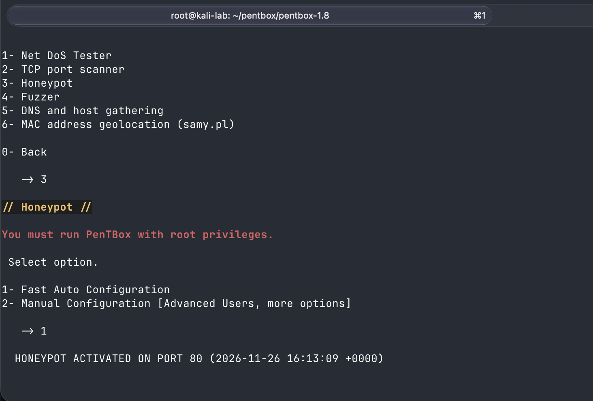
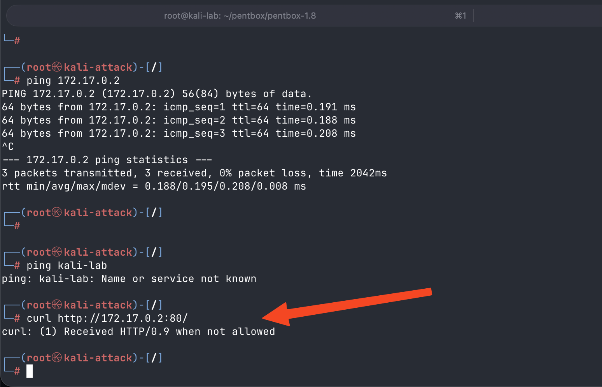
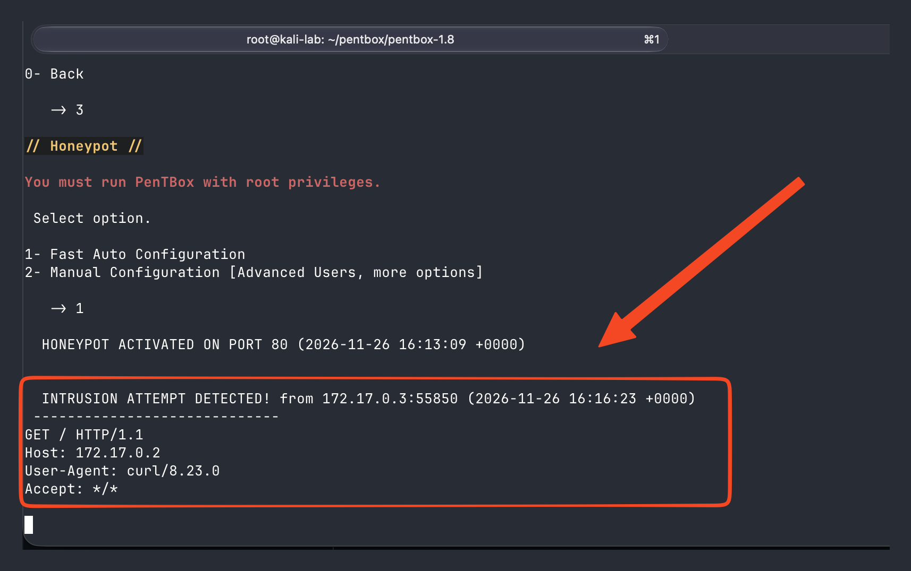

# Dokumentation: Pentbox-Honeypot

## 1. Ausgangslage und Ziel

Im Rahmen des Arbeitsauftrags **Honeypots** wurde der Honeypot von **Pentbox 1.8** installiert und getestet. Das Ziel bestand darin, erste praktische Erfahrungen mit der Einrichtung eines Honeypots zu sammeln, einen Verbindungsversuch gegen den Honeypot auszuführen und anschliessend zu prüfen, welche Informationen Pentbox protokolliert.

Für die Durchführung wurden zwei Kali-Linux-Container verwendet:

- **kali-lab**: Zielsystem mit Pentbox und aktiviertem Honeypot
- **kali-attack**: separates Testsystem, von dem aus der Verbindungsversuch durchgeführt wurde

Die Tests fanden ausschliesslich innerhalb der lokalen Docker-Umgebung statt.

## 2. Kurzbeschreibung von Pentbox

Pentbox ist ein in Ruby geschriebenes Security-Toolkit. Neben Funktionen wie Port-Scanning, DoS-Tests und Fuzzing enthält Pentbox einen einfachen Low-Interaction-Honeypot. Dieser öffnet einen ausgewählten TCP-Port, wartet auf eingehende Verbindungen und protokolliert Informationen wie Quell-IP, Quellport, Zeitpunkt und übertragene Daten.

Pentbox bildet dabei keinen vollständigen echten Dienst nach. Der Honeypot eignet sich deshalb hauptsächlich für einfache Demonstrationen sowie zum Erkennen und Protokollieren von Verbindungsversuchen.

## 3. Verwendete Umgebung

| Komponente | Verwendung |
|---|---|
| Docker | Bereitstellung der isolierten Testumgebung |
| Kali Linux Rolling | Betriebssystem der beiden Container |
| Pentbox 1.8 | Honeypot auf dem Zielsystem |
| Ruby | Ausführung von Pentbox |
| curl | Senden einer HTTP-Anfrage an den Honeypot |
| ping | Prüfung der Netzwerkverbindung zwischen den Containern |

## 4. Kali-Container erstellen

Der Kali-Container für das Lab wurde ohne die Option `--rm` erstellt. Dadurch bleibt der Container nach dem Beenden erhalten und kann später erneut gestartet werden. Zusätzlich wurde ein Docker-Volume verwendet, damit die Daten unter `/root` persistent gespeichert werden.

```bash
docker run -it \
  --name kali-lab \
  --hostname kali-lab \
  -v kali-data:/root \
  kalilinux/kali-rolling \
  /bin/bash
```

Nach dem Beenden kann derselbe Container erneut gestartet werden:

```bash
docker start -ai kali-lab
```

Für den kontrollierten Verbindungsversuch wurde ein zweiter Kali-Container mit dem Hostnamen `kali-attack` verwendet. Beide Container mussten sich im gleichen Docker-Netzwerk befinden, damit eine direkte Kommunikation über die internen Container-IP-Adressen möglich war.

## 5. Pentbox installieren

Zuerst wurden die Paketquellen aktualisiert und die benötigten Pakete installiert:

```bash
apt update
apt install -y ruby git
```

Danach wurde Pentbox heruntergeladen beziehungsweise in das Arbeitsverzeichnis kopiert. Anschliessend wurde in das Verzeichnis von Pentbox 1.8 gewechselt:

```bash
cd ~/pentbox/pentbox-1.8
```

Pentbox wurde mit Ruby und Root-Berechtigungen gestartet:

```bash
ruby pentbox.rb
```

Root-Berechtigungen sind insbesondere nötig, wenn Pentbox einen privilegierten Port unterhalb von `1024`, beispielsweise TCP-Port `80`, öffnen soll.

## 6. Honeypot konfigurieren und starten

Im Hauptmenü wurde zuerst der Menüpunkt für die Netzwerkwerkzeuge und danach die Option **Honeypot** ausgewählt. Im Honeypot-Menü wurde die **Fast Auto Configuration** verwendet.

Pentbox aktivierte daraufhin automatisch einen Honeypot auf **TCP-Port 80**:

```text
HONEYPOT ACTIVATED ON PORT 80
```

Der folgende Screenshot zeigt die Auswahl des Honeypots, die automatische Konfiguration und den erfolgreich geöffneten TCP-Port 80.



## 7. Netzwerkverbindung prüfen

Vom Container `kali-attack` wurde zuerst geprüft, ob das Zielsystem unter der internen Docker-IP-Adresse `172.17.0.2` erreichbar ist:

```bash
ping 172.17.0.2
```

Das Ziel antwortete erfolgreich. Im Test wurden drei ICMP-Pakete übertragen und alle drei empfangen. Der Paketverlust betrug somit `0 %`.

Der Zugriff über den Hostnamen `kali-lab` funktionierte dagegen nicht:

```bash
ping kali-lab
```

Die Ausgabe `Name or service not known` zeigte, dass der Hostname in dieser Docker-Konfiguration nicht aufgelöst werden konnte. Für den weiteren Test wurde deshalb direkt die IP-Adresse `172.17.0.2` verwendet.

## 8. Honeypot testen

Für den Test wurde vom Container `kali-attack` eine einfache HTTP-Anfrage an TCP-Port 80 des Honeypots gesendet:

```bash
curl http://172.17.0.2:80/
```

`curl` meldete folgende Antwort:

```text
curl: (1) Received HTTP/0.9 when not allowed
```

Diese Meldung entstand, weil Pentbox keinen vollständigen modernen HTTP-Webserver bereitstellt. Der Port war zwar erreichbar und nahm die Verbindung entgegen, die Antwort entsprach jedoch nicht dem von `curl` erwarteten HTTP/1.x-Format.



## 9. Protokollierung durch Pentbox

Der Verbindungsversuch wurde vom Honeypot erfolgreich erkannt und direkt im Terminal angezeigt. Pentbox protokollierte unter anderem folgende Informationen:

- Ereignis: `INTRUSION ATTEMPT DETECTED!`
- Quell-IP-Adresse: `172.17.0.3`
- Quellport: `55850`
- Ziel-IP-Adresse: `172.17.0.2`
- Zielport: `80`
- Zeitpunkt: `2026-11-26 16:16:23 +0000`
- HTTP-Methode und Pfad: `GET / HTTP/1.1`
- HTTP-Host-Header: `Host: 172.17.0.2`
- User-Agent: `curl/8.23.0`
- Accept-Header: `*/*`

Die Quell-IP `172.17.0.3` gehörte im Test zum Container `kali-attack`. Die Ziel-IP `172.17.0.2` gehörte zum Container `kali-lab`, auf dem Pentbox ausgeführt wurde.



## 10. Erkenntnisse aus dem Test

Der praktische Test zeigte, dass Pentbox sehr einfach eingerichtet werden kann. Mit der automatischen Konfiguration konnte innerhalb kurzer Zeit ein über das Netzwerk erreichbarer Honeypot auf TCP-Port 80 gestartet werden.

Pentbox erkannte den Verbindungsversuch von `curl` korrekt und zeichnete wichtige Metadaten sowie den Inhalt der HTTP-Anfrage auf. Dadurch konnte nachvollzogen werden, von welcher IP-Adresse und welchem Quellport die Verbindung ausging und welches Programm die Anfrage gesendet hatte.

Gleichzeitig wurde deutlich, dass Pentbox nur einen einfachen Low-Interaction-Honeypot bereitstellt. Der Dienst verhält sich nicht wie ein vollständiger Webserver. Ein erfahrener Angreifer könnte deshalb anhand der ungewöhnlichen Antwort relativ schnell erkennen, dass kein echter HTTP-Dienst vorhanden ist.

### Vorteile

- einfache und schnelle Einrichtung
- geringer Ressourcenverbrauch
- frei wählbare beziehungsweise automatisch festgelegte Ports
- Anzeige der Quell-IP und des Quellports
- Protokollierung der übertragenen Anfrage
- gut geeignet für Schulungs- und Demonstrationszwecke

### Nachteile

- keine realistische Simulation eines vollständigen Dienstes
- weniger detaillierte Analysefunktionen als umfangreichere Honeypots wie Cowrie
- keine integrierte grafische Auswertung oder SIEM-Anbindung
- Pentbox ist ein älteres Toolkit und nicht speziell als moderne Honeypot-Plattform entwickelt
- der Honeypot könnte aufgrund der einfachen Antworten erkannt werden

## 11. Sinnvolle Einsatzmöglichkeiten

Pentbox kann sinnvoll eingesetzt werden, wenn in einer isolierten Laborumgebung schnell demonstriert werden soll, wie ein Honeypot eingehende Verbindungen erkennt. Denkbare Anwendungsfälle sind:

- Einführung in das Thema Honeypots
- Demonstration von Port-Scans und Verbindungsversuchen
- Überwachung eines nicht verwendeten TCP-Ports in einem Testnetz
- Analyse einfacher HTTP- oder TCP-Anfragen
- Vergleich mit umfangreicheren Honeypots wie Cowrie oder Beelzebub

Für den produktiven Einsatz in einem Unternehmensnetzwerk wäre hingegen eine aktiv gepflegte Lösung mit detailliertem Logging, sicherer Isolation und SIEM-Integration besser geeignet.

## 12. Fazit

Das Ziel des Arbeitsauftrags wurde erreicht. Pentbox wurde in einem Kali-Linux-Container gestartet, der Honeypot wurde auf TCP-Port 80 aktiviert und von einem zweiten Container aus getestet. Der Verbindungsversuch wurde erfolgreich erkannt und mit Quell-IP, Quellport, Zeitstempel sowie der vollständigen HTTP-Anfrage protokolliert.

Pentbox eignet sich gut, um die grundlegende Funktionsweise eines Honeypots zu verstehen. Für komplexere oder realistischere Analysen ist Pentbox jedoch nur eingeschränkt geeignet, da kein vollständiger Netzwerkdienst simuliert wird.
